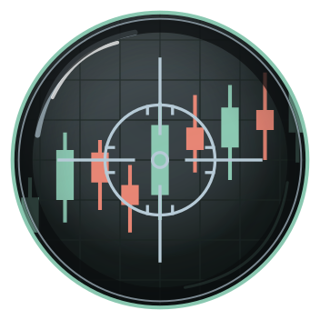
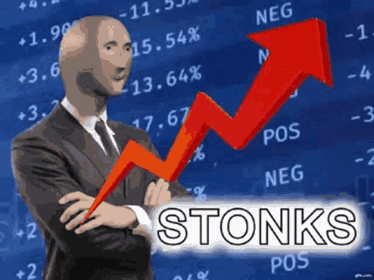
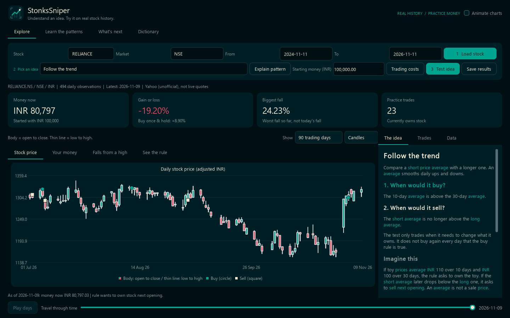
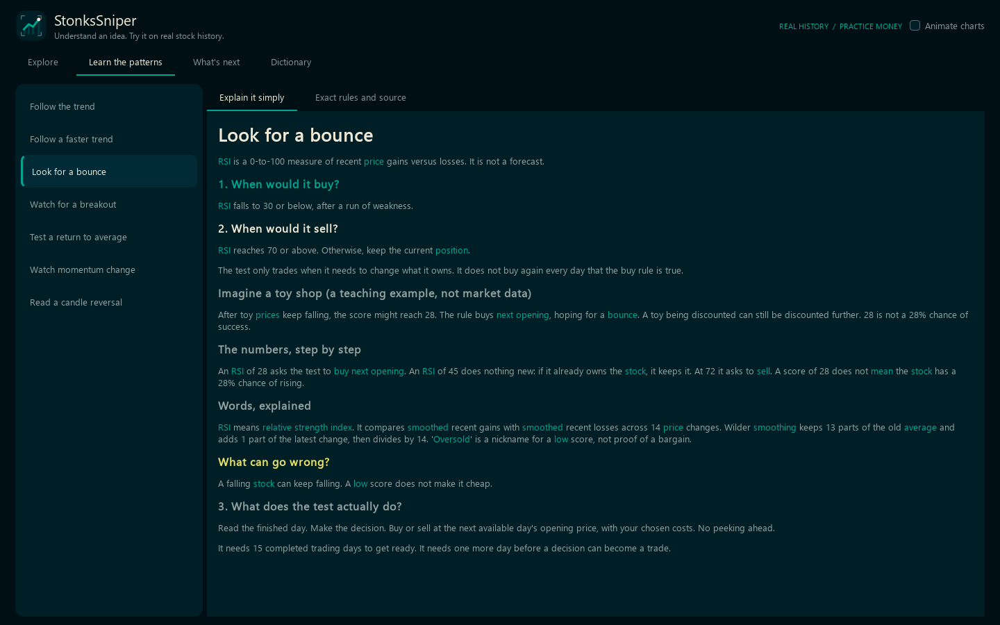
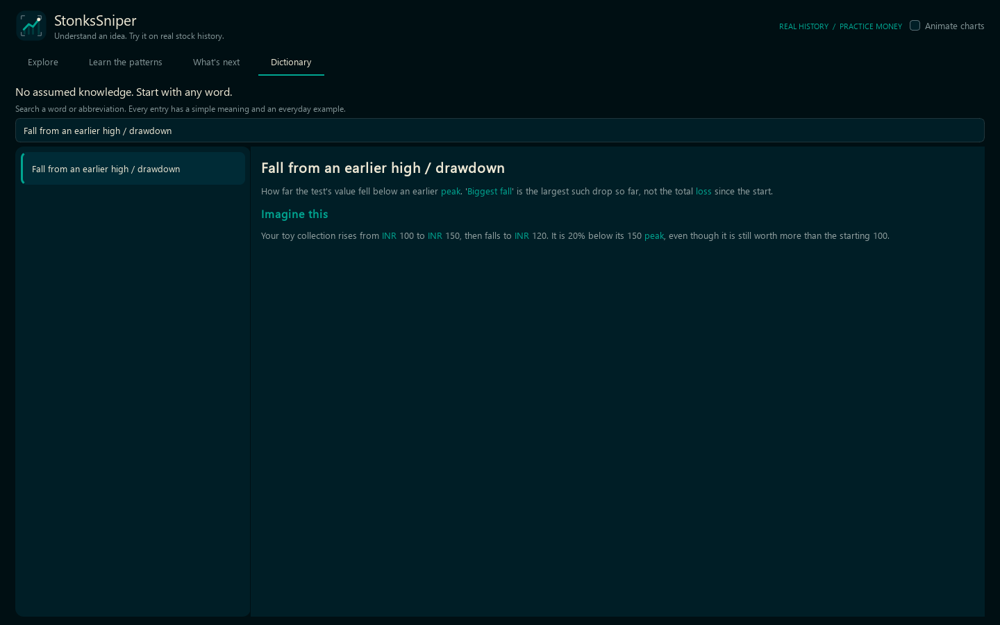
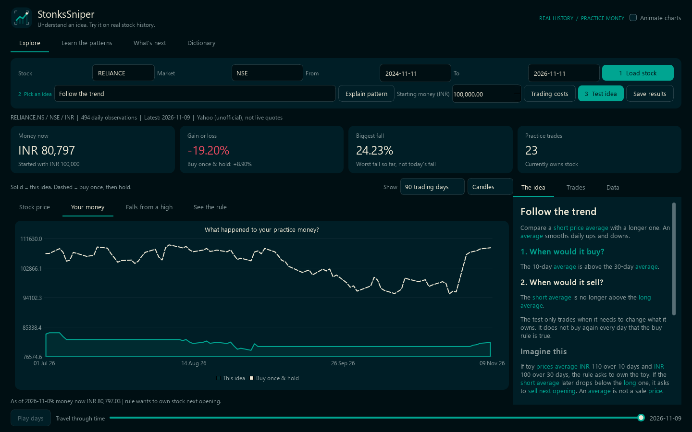
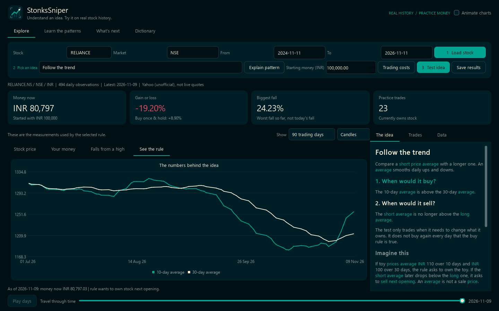
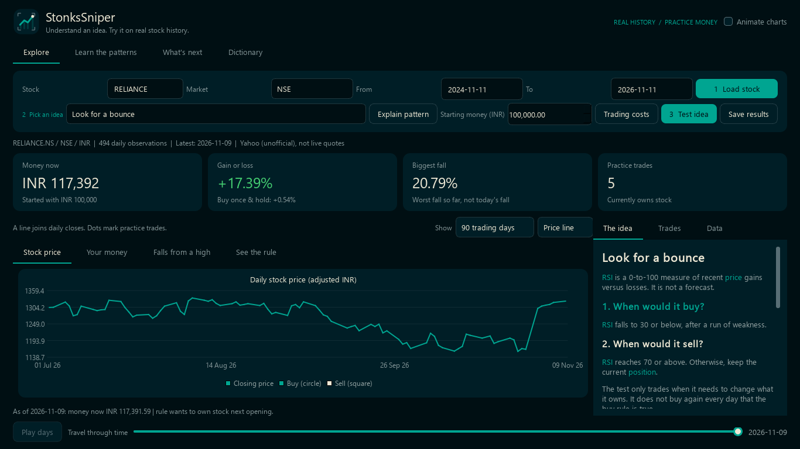

<p align="center">
  
</p>

# StonksSniper

<p align="center">
  
</p>

*The meme brings the hype. The app explains the ideas.*

**Learn a stock-market idea. Understand every word. Try it with practice money.**

A local Windows app with real Indian stock history, seven explained buy/sell
rules and a calm [DeepSeaFoam](https://github.com/Zanark/DeepSeaFoam) interface.
No stock-market knowledge is assumed.

## Load a stock. Pick an idea. Explain it. Test it.


*Actual RELIANCE history, practice trades and a plain-English explanation beside the chart.*

## The explanation comes with the pattern


*Explain pattern teaches when it buys, when it sells and what can go wrong, with a toy-shop example.*

## No unexplained vocabulary


*Hover a highlighted word for its meaning and an everyday example. Click or activate it with the keyboard to open Dictionary; search names or abbreviations.*

## See what happened, not just a score


*The solid line follows your chosen rule. The dashed line buys once and waits. Both use the chosen trading costs.*


*See the rule shows its actual calculations. Play days replays history without revealing later results; Animations can turn motion off.*


*The main workspace fits 1366 x 768 without a page scrollbar. Longer lessons and trade lists scroll only inside their own panels.*

These are captures of the native application, not dashboard mockups.
[Capture dates and source](docs/images/captures.json) are recorded separately.

## Run locally

**[Download the first prototype](https://github.com/Zanark/StonksSniper/releases).**
The release includes a Python package and source code, not a standalone Windows
installer. Python 3.11 or newer is required; installation steps are on the release.
The loading GIF is in the current source; the v0.1.0 package predates it.

Windows, Python 3.11 or newer:

```powershell
Set-Location C:\devdesk\homedesk\StonksSniper
python -m venv .venv
& .\.venv\Scripts\python.exe -m pip install -e '.[dev]'
& .\.venv\Scripts\python.exe -m stonks_sniper
```

Once installed:

```powershell
& C:\devdesk\homedesk\StonksSniper\.venv\Scripts\python.exe -m stonks_sniper
```

Try `RELIANCE` on **NSE**, or `TCS` on **BSE**. **Load stock** downloads history
and runs the first test, with the Stonks GIF while you wait. Turn off **Animations**
to keep it still. After changing an idea or cost, click **Test idea**.
**Save results** keeps the full test and exact prices, not just the visible day.

## Real history, clear boundaries

The free, unofficial Yahoo connection needs no API token. This is completed
daily history, **not live prices**. Unavailable data produces an error, never
made-up replacements. Older prices are rescaled for changes to shares and
payments to owners; **Data** explains why these test quantities are not literal
historical share purchases. Later downloads can change earlier values.

Seven rules work today. More patterns, multi-stock baskets and AI-proposed
ideas are [planned, not implemented](TODO/00_INDEX.todo).

[How the simulator works](docs/product-and-architecture.md) |
[Data sources](docs/data-providers.md) | [Design and explanation contract](docs/ui-design.md) |
[Development](docs/development.md) | [Project board](https://github.com/users/Zanark/projects/14)

For education and simulation only; not investment advice or a guarantee of results.
