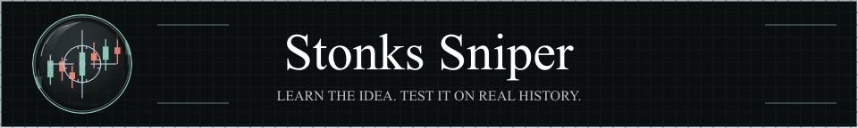
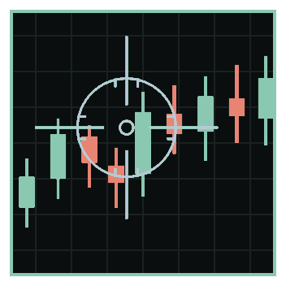
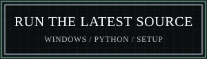
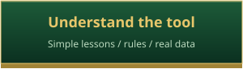
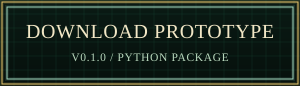
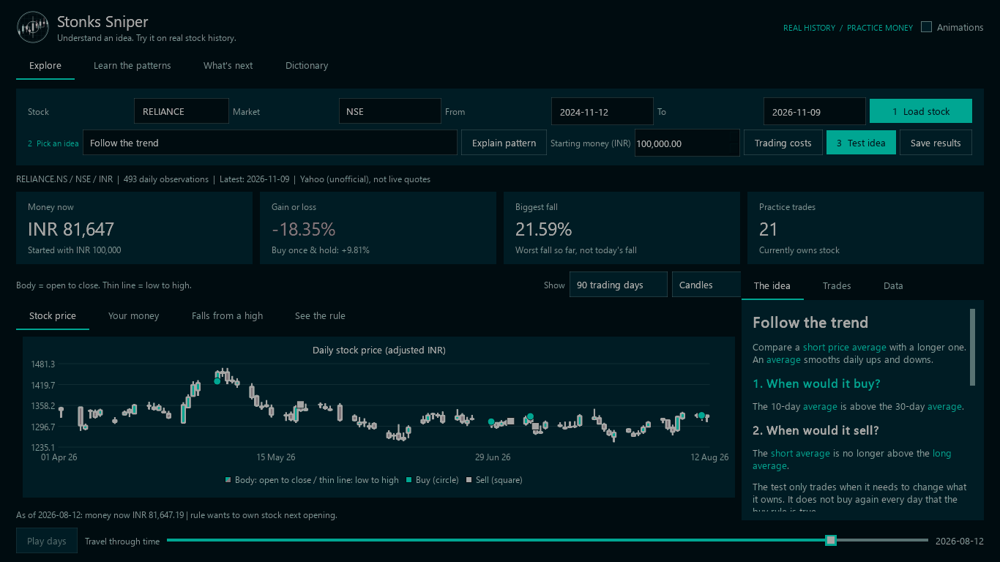
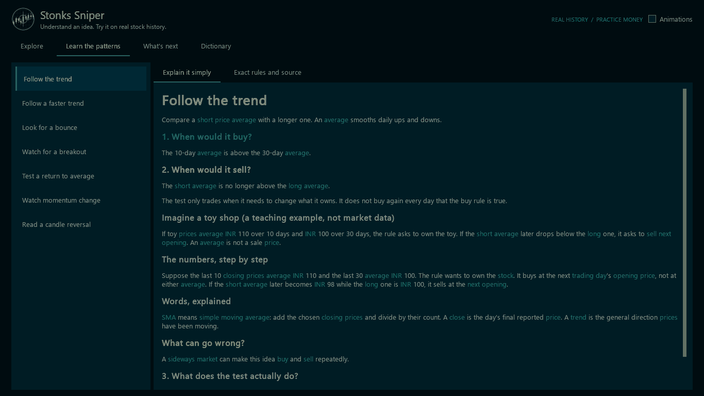
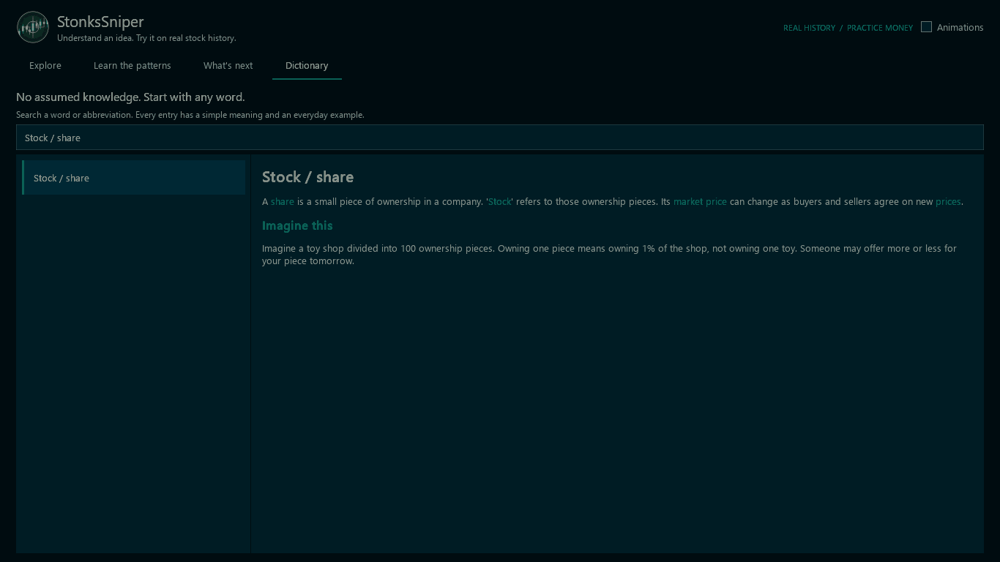
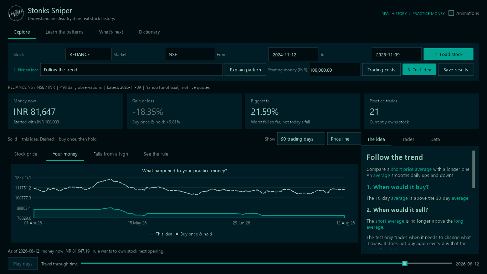
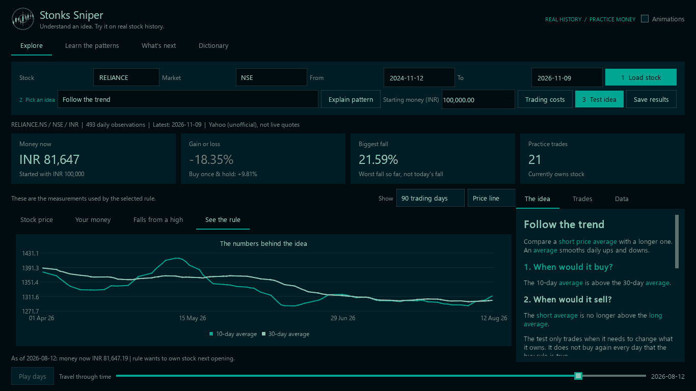

  

  

<b>Real history. Practice money. Every word explained.</b>

  
  
  

Windows prototype: download the .exe; no Python or administrator install required. Unsigned; internet required for Yahoo history. <a href="docs/getting-started.md">Run instructions</a> · <a href="docs/guide.md">Written guide / no-motion alternative</a> · <a href="src/stonks_sniper/assets/logo.svg">Still logo</a> · <a href="src/stonks_sniper/assets/logo.ico">Windows / browser icon</a>

## Pick a stock. Test an idea.

*Actual history, revealed day by day. No made-up market data.*

## Understand before you test.

*What it buys, what it sells, what can fail — with everyday examples.*

## Every unfamiliar word has a way in.

*Meaning + example. Hover, click or search.*

## Watch your practice money.

*The rule versus buying once. Same prices. Same costs.*

## See why the rule acted.

*No mystery score. See the measurements behind the decision.*

  

The meme brings the hype. The app explains the ideas.

<a href="docs/strategies.md">All 27 strategies, explained</a> · <a href="docs/guide.md">Rules, sources &amp; limits</a> · <a href="docs/images/gif-captures.json">GIF provenance</a> · <a href="docs/development.md">Build &amp; development</a> · <a href="TODO/00_INDEX.todo">Roadmap</a>

Completed daily history, not live prices. 27 explained rules; baskets and AI are planned. For education and simulation, not investment advice.

GPLv3 application, including GPLv3 Qt Charts. <a href="LICENSE">License</a> · <a href="packaging/THIRD_PARTY_NOTICES.md">Third-party notices</a> · <a href="packaging/SOURCES.md">Corresponding source</a>

