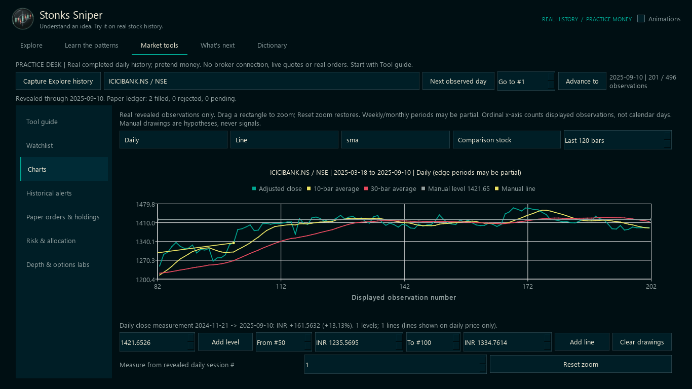

# Market tools: learn the terminal without a brokerage account

[App guide](guide.md) | [Exact algorithms](strategies.md) | [Agent lab](agent-lab.md)

**Latest source only. The unchanged v0.3.0 executable does not include this desk.**
This is an independent educational adaptation, not Zerodha software, a Kite
clone, an investment recommendation or a promise of complete feature parity.

## 1. Start with one practical

1. In **Explore**, fetch `ICICIBANK` / NSE and a historical interval. The market
   need not be open. Failed requests stay failures; no substitute prices appear.
2. Open **Market tools -> Tool guide**. Search a term or follow the first lesson.
   Twenty original lessons explain what each tool does, a household example,
   an exercise, failure modes and official background sources. These explanations
   also appear in the searchable **Dictionary**.
3. Click **Capture Explore history**. This captures immutable observations,
   their source, fetch time, adjustment basis and warnings. No hidden fetch occurs.
   Only the first completed session is initially revealed.
4. Choose **Charts**, then **Next observed day** or a later **Session # -> Advance
   to**. Advancing examines every intermediate opening and close; it is not a
   shortcut that skips pending instructions. The paper clock cannot rewind.
5. Add a close-crossing study in **Historical alerts**. In **Paper orders &
   holdings**, queue a one-unit market instruction. It is an instruction, not
   yet a trade. Advance to inspect its assumed next-opening fill.
6. Inspect cash, realised/unrealised P&L, cost and fees. A gain in unsold stock
   is not cash. Export the session before resetting, replacing its captured
   history or selecting another instrument.
7. Fetch another stock in Explore and capture it. Use **Watchlist** for dated
   snapshots and **Charts -> Compare (100)** for exactly shared daily sessions.
   Capture/switch starts a fresh single-stock practice exercise; it does not
   combine the two accounts.

**Do not pick a profitable interval and call that proof.** Write your hypothesis
before looking ahead. The manual exercise is different from the existing
algorithm **Simulate** engine; neither can predict a trustworthy future return.

## 2. Research-to-feature map


*Owned source-native view at 1366x768: real ICICIBANK observations revealed
through 2025-09-10. The drawn level/line are manual hypotheses, not detected
patterns or recommended trades. Current/future captured observations are hidden.*

The official Kite manual chapters below were read on **2026-11-23**, alongside
the current GTT support article. Manual and support can disagree or describe
older products. We adapt concepts, not screenshots, broker limits or promises.

| Tool family | Working practice equivalent | Deliberate limit |
|---|---|---|
| Marketwatch | Capture multiple real histories, select instruments, sortable dated OHLCV/change/study snapshots, remove identifiers, save/load watchlist JSON | No live LTP, streaming, cloud sync or universal instrument database |
| Quote/depth fields | Actual completed adjusted OHLC, reported volume, change versus previous observation, provenance and warnings | No bid/ask/LTT/LTQ, circuit bands or intraday VWAP inferred from candles |
| Charts | Line/candles, volume, daily/ISO-week/month aggregation, recent-bar window, drag zoom/reset, close hover | No fabricated intraday observations or proprietary chart-engine embed |
| Studies | Shared SMA10/30, EMA12/26, Bollinger and Donchian price guides; all 27 rule demos remain under Learn | No claim of 100 indicators; oscillator guides stay in their existing lessons |
| Drawing/measuring | Multiple horizontal levels, revealed-daily-session two-point lines, close-to-close INR/% measurement | Manual hypotheses, not auto-detected support/resistance |
| Comparison | Both series rebased to 100 on first exactly shared revealed session | No forward fill, different-start performance ranking or portfolio execution |
| Alerts | All revealed completed-close crossings above/below a chosen level | Historical inspection, not cloud alerts, email, ATO, scheduling or execution |
| Orders | Opening-only market, limit, stop market, stop limit, local persistence/expiry, cancellation and explicit rejection reasons | Not exchange tick execution, intraday stops, cash reservation or partial fills |
| Holdings/positions/funds | Single-stock long/cash ledger, fee-inclusive average cost, realised/unrealised P&L, marked INR/% and paper-money graph | Not broker buying power, demat delivery, settlement, tax lots or Console reporting |
| Cost/risk tools | Hypothetical whole-unit sizing, risk budget, affordability, net reward/risk and break-even with editable proportional costs | No broker-specific Indian charge schedule, gap-loss guarantee or SPAN calculator |
| Baskets/SIP | Percentage allocation budgets/reserve; existing book chapter 5 actual-history equal-money exercise | No shared-cash basket fills, margin netting, rebalancing or unattended SIP scheduler |
| Depth learning | Explicit manual bid/ask inputs, best quotes, spread and displayed quantities | Never labelled an actual exchange order book |
| Options learning | Manual bought-call/put expiry payoff, premium loss, break-even and settlement scenarios | No live chain/OI, Greeks valuation, implied volatility, shorts or physical-settlement funding model |
| GTT/OCO/trailing/AMO | Original trigger-versus-fill, gap and scheduling lessons with current official links | No pretend broker service or app-closed monitoring |
| Advanced execution | Lessons on IOC/minute validity, iceberg, cover orders, queues and liquidity | Not simulated from insufficient daily observations |
| News/calendar/IPO/circuits | Beginner explanations, warnings and official notices/calendar links | No stale notice masquerades as current news, no IPO application or guessed holiday calendar |
| Third-party widgets/APIs | Distinguishes Kite, Console, Varsity, ChartIQ/TradingView, smallcase, Streak and Sensibull | No external account, copied terminal, premium integration or embedded LLM |

SS-08 (shared-cash baskets), SS-10 (complete study persistence/recovery) and SS-12
(qualified read-only broker integrations) remain separate unfinished workstreams.
Educational budget arithmetic does not complete them.

## 3. Understand the clocks and the data

The top date is the **revealed daily close**. Watchlist rows and comparisons
use only observations on/before that date; each stock's own observation date is
displayed. A stock without an observation at the cutoff can have an earlier
dated snapshot, never a silently forward-filled one. Earlier observations may
be stale; this is a historical desk, not a current screener.

Changing the Explore stock/data/algorithm does not mutate an already captured
practice snapshot. Switching/capturing/resetting warns before discarding orders,
alert studies or drawings. A watchlist file contains **identifiers only**.
Loading it neither authenticates the ticker nor downloads market data.
Double-click a captured row to select it; an uncaptured row explains that you
must fetch/capture it first.

Weekly grouping uses ISO week-year, including weeks crossing New Year.
Monthly grouping uses calendar year/month. Each bucket's open is its first
observed open, high/low are extrema, close is its last observed close and
volume is summed. The label is the **last observed date**. First/last periods
can be partial; holidays/missing sessions are not created. Indicator periods
count the displayed bars, so a 10-bar weekly average is not SMA10 daily.
Manual two-point lines use daily session numbers and appear on daily price
views only; horizontal levels are price-only. Comparison and paper money
are explicitly daily views regardless of the previous chart timeframe.

Yahoo's split/dividend-adjusted OHLC is a research proxy. Fractional adjusted
units are not literal purchasable historical shares. Do not separately credit
cash dividends or mix these prices with nominal EPS/option premiums.
Current-day bars remain excluded even after close. Closed-market availability
does not guarantee provider accuracy, completeness or uptime.

## 4. Opening-only paper instructions: exact contract

This is a **separate manual exercise**, not a change to `engine.simulate`:
the existing 27 algorithm rules still make completed-close target decisions
and fill next open through their original engine.

1. Start with the chosen pretend capital, no units and no orders. Fee/slippage
   settings are captured on Start/reset. Editing them does not retroactively
   reprice the active account; its actual assumptions are printed above holdings.
2. Submit only after the current revealed close. The submission is recorded;
   it does not spend cash. Earlier/same-date openings cannot fill it.
3. Advance to the next actual observation. Process pending orders in submission
   order using that opening and the cash/units available after earlier fills.
   There is **no cash reservation** or real order-acceptance guarantee.
4. Market orders assume a full fill at the opening with adverse slippage.
   A buy limit is eligible only when open <= limit; a sell limit only when
   open >= limit. Adverse slippage is capped at the limit, never beyond it.
   A daily low/high touching a limit does **not** fill it in this model.
5. A buy stop activates only when a later opening >= trigger; a sell stop only
   when open <= trigger. Stop market uses the gapped opening, not a guaranteed
   trigger price. Stop limit becomes an ordinary limit once activated.
   For these entry fields buy limit >= trigger; sell limit <= trigger.
6. **Next opening** is local exercise validity: an unexecutable order expires
   after this one eligible opening, even if a real intraday touch could occur.
   **Until cancelled** persists across observations. Neither label means Kite
   DAY, GTT or exchange validity. A persistent activated stop limit remains
   active even if a later opening moves back across the trigger.
7. Reject unaffordable buys and unowned sells explicitly; no leverage, shorts
   or partial fills. Pending instructions can be cancelled. To modify, cancel
   and submit a replacement; the original row stays in the ledger.
8. Charge `units * fill_price * fee_bps / 10000` each side. Buys add gross value
   plus fee to cost. Sales remove proportional average cost and realise net
   proceeds minus that cost. Do not interpret this as FIFO tax accounting.
9. At every revealed close, equity = cash + units * close. Unrealised P&L =
   marked stock minus remaining cost. The final session does not force a sale.
   A last-day instruction cannot be filled, so the GUI refuses to queue it.

Liquidity, auctions, volatility/circuit restrictions, exchange tick sizes,
real lots, partial fills, settlement, corporate-action handling of pending
orders and broker charges are not simulated. Use this model to understand
instructions, not to predict real fills or protective-stop outcomes.

## 5. Risk, allocation, depth and options arithmetic

All inputs in the last two pages are **manual assumptions**, never fetched
signals. Initial example numbers are labelled manual scenarios, not real prices.

For fee fraction `f`, adverse slippage `s`, reference entry `E`, stop `S`,
target `T`, capital `C` and risk percentage `r`:

```text
entry cost per unit  = E * (1+s) * (1+f)
stop proceeds        = S * (1-s) * (1-f)
target proceeds      = T * (1-s) * (1-f)
planned loss/unit    = entry cost - stop proceeds
risk budget          = C * r / 100
units                = floor(min(C / entry cost, risk budget / planned loss))
net reward/risk      = (target proceeds - entry cost) / planned loss
break-even exit      = entry cost / ((1-s) * (1-f))
```

Requires `0 < S < E < T`, `0 < r <= 100`, and fee/slippage each from zero
to less than 10,000 bps. Positive money/price inputs are bounded at 1e15.
Zero affordable units is a valid result. Negative net reward/risk can occur
when costs overwhelm the target. Stop gaps can exceed the planned loss.
Integer nominal-price planning is intentionally distinct from adjusted
historical research units. This is not a complete Indian charge calculator.

Allocation budget `i = capital * weight_i / 100`; nonnegative weights sum
to at most 100. The rest is unallocated zero-interest cash. No market P&L or
diversification is inferred from this arithmetic.

Manual depth requires positive prices/quantities and best bid < best ask.
Spread = min(asks) - max(bids). Displayed quantities do not guarantee liquidity.

For total **underlying units**, strike `K`, per-unit premium `P` and expiry
settlement `X`:

```text
bought call P&L = units * (max(X-K, 0) - P)
bought put P&L  = units * (max(K-X, 0) - P)
```

This excludes costs and values only expiry payoff, not the pre-expiry option
price. Strike/premium/unit counts are not fetched. Lots must be converted to
total underlying units explicitly. Premium loss is not a physical-settlement
funding model; exercise/delivery can need additional funds. No short option
writing, automatic margin estimate or derivative recommendation is provided.

## 6. Files and agent use

**Save list as new JSON** writes validated schema-1 instrument identifiers.
**Load list JSON** enforces a 32-KiB bound, exact fields/types, unique entries,
matching exchange suffixes and a 50-instrument limit. It replaces only the
watchlist identifiers, not captured accounts or network data.

**Export session as new JSON** captures active real observations/provenance,
revealed date, capital/costs, orders with status/reasons/update dates, balances,
equity marks, historical alert studies, drawings and chart settings. If using
comparison it also includes that snapshot. The export explicitly contains
**future captured bars beyond the revealed cursor**; it is not a prefix-only
or authenticated market receipt. Save outside source control. Existing files
are refused, not silently overwritten. Files are evidence exports; paper-session
import/resume is not implemented. Closing loses unsaved in-memory exercises.

Agents can import the GUI-free `stonks_sniper.market_tools` module to use
`grouped_bars`, `comparison`, `crossings`, `position_size`, `allocation`,
`depth_summary`, `option_payoff` or `PaperAccount`. Feed actual validated
`MarketData`/`Candle` inputs for historical exercises; manual calculator inputs
must stay labelled hypothetical. For strategy experiments, continue using
the [headless lab](agent-lab.md) and its existing shared algorithm engine.

## 7. Official source receipts and access limits

Reviewed **2026-11-23**, public pages, no broker/account session:

- [Marketwatch](https://kite.trade/docs/kite/marketwatch/): watchlists,
  OHLCV/quote fields, depth, sorting, instrument menus.
- [Orders](https://kite.trade/docs/kite/orders/): order types/lifecycle,
  validity, baskets, SIP, AMO/GTT/OCO, alerts and advanced orders.
- [Charting](https://kite.trade/docs/kite/charting/): chart engines, timeframes,
  studies, drawings, relative comparison, multi-chart views.
- [Portfolio](https://kite.trade/docs/kite/portfolio/): holdings, positions,
  cost/P&L and separate Console analytics.
- [Funds](https://kite.trade/docs/kite/funds/): cash/margin/collateral
  distinctions, not permission to move money.
- [Widgets](https://kite.trade/docs/kite/widgets/): explicitly attributes
  fundamental, option-chain/Greeks and technical widgets to separate providers.
- [Utilities](https://kite.trade/docs/kite/utilities/): brokerage/margin
  calculators, notices, holidays, news, Q&A and Varsity education.
- [Current GTT support](https://support.zerodha.com/category/trading-and-markets/charts-and-orders/gtt/articles/what-is-the-good-till-triggered-gtt-feature):
  protected-market variants, trailing stops, one-shot triggers, gap conditions.
  This is more current than the manual's limit-only GTT wording; neither is
  copied into a fictitious app-closed service here.
- [Settlement support](https://support.zerodha.com/category/trading-and-markets/trading-faqs/general/articles/what-does-settlement-cycle-i-e-rolling-settlement-mean):
  current rolling-settlement explanation, contrasting the manual's old T+2
  paragraph. The desk does not implement a settlement calendar.

Direct guesses `/charts/`, `/holdings/`, `/positions/` and an initial guessed
T+1 support slug returned 404; actual chapter paths were obtained from the
manual navigation/search. A separate generic HTTP client received 403 on the
manual landing page; normal document retrieval succeeded. No login, restriction
bypass, private API or broker integration was used. Marketing counts, broker
limits and old holiday links are not treated as verified current capabilities.
