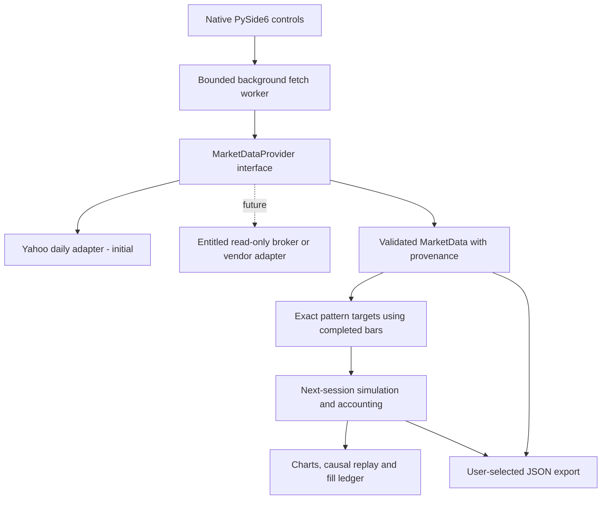

# Product contract and architecture

## Agreed scope

**Product identity: learn from zero, not a trading terminal for experts.**
StonksSniper is a practice playground: pick a real stock, learn a simple rule,
and see what that rule would have done with pretend money on actual history.
ELI15 means explain it so a curious 15-year-old can follow, not assume a younger
user already knows financial vocabulary. It is not a claim that comprehension
has been tested with children.

Every pattern needs a plain-English purpose, explicit buy/sell steps, an everyday
analogy using toys, vegetables or household items, a worked example and a failure
explanation. Basics such as a share, a market, cash and an average need help too.
Technical names may appear for learning and precision, but never replace the
explanation. Hover help must have a clickable/keyboard-accessible dictionary
equivalent. A pattern explanation button opens the selected lesson; a searchable
dictionary accepts common terms and abbreviations. Unknown terms remain explicit
gaps, never fabricated explanations.

Teaching examples may use invented toy prices, conspicuously labelled as
illustrations. They must never supply chart observations, simulation inputs or
claims about actual stocks. The real-data-only contract below remains unchanged.
Future catalogue, basket and AI work must follow the same ELI15 contract before
being presented as usable features.

StonksSniper is a native Windows desktop learning laboratory, implemented in Python
and PySide6. Indian NSE/BSE equities come first. The user selects a stock and a
pattern, studies its exact rules, and replays simulated decisions against actual
market observations. Free delayed/end-of-day data is acceptable when labelled.
Future broker/data-provider integrations must not require replacing the engine.

No broker order execution is in scope. No fabricated market history or fallback
demo prices are permitted. Unit-test arithmetic fixtures are isolated under
`tests`; they never supply application observations.

"Every pattern ever developed" is an open-ended research ambition, not a
verifiable completeness promise. Catalogue coverage is enumerated and sourced.
Indicator background is not proof of strategy efficacy. AI-generated strategies
will be hypotheses, not established market patterns or validated recommendations.

## M1: working daily-data vertical slice

- Explicit NSE/BSE symbol and inclusive date-range selection.
- Personal-research Yahoo/yfinance adapter; no account or API key needed.
- Provider, exchange, currency, interval, fetch time, last observation and price
  adjustment basis shown beside results.
- Validate finite positive OHLC, bounds, nonnegative volume, unique ordered
  sessions, INR and provider exchange. Reject malformed data; no auto-repair.
- Exclude current-day observations conservatively, including after market close.
  Last-observation age is not proof of exchange-calendar completeness.
- Seven exact, long/cash teaching variants: SMA, EMA, Wilder RSI, Donchian,
  Bollinger, MACD and body engulfing.
- Close-derived targets fill only at the next available daily open, with adverse
  slippage and proportional fees. No shorts, borrowing or leverage.
- Daily chart, fill ledger, equity/benchmark curves, causal replay and JSON export
  including the observations, parameters, provenance and rules.

This is a research proxy using provider-adjusted OHLC and fractional research
units. Adjusted prices are transformations of actual observations, not the
historical cash prices at which a real share could have traded. Dividend/split
adjustments are not applied a second time. No claim is made that any provider is
error-free. A strict market-data guarantee requires reconciliation and licensed
exchange/provider qualification beyond this slice.

## Next releases

1. Qualify authoritative daily data, action handling, holidays, suspensions,
   delistings and versioned snapshots; integrate an entitled read-only broker feed.
2. Continue the sourced catalogue: [20 additional daily strategies](strategies.md)
   now extend the original seven. Confirmed candlestick/price structures,
   multi-timeframe and statistical families remain planned.
3. Portfolio baskets with shared cash, allocations, correlated assets, rebalancing,
   costs and instrument/date alignment. Use "basket", not a claimed smallcase
   service integration.
4. Declarative strategy composition and AI hypothesis generation, with schema
   validation, provenance, fixed holdouts, walk-forward tests and data-snooping
   controls. No generated Python execution or model-reported performance.
5. Persistence, study notebooks, comparison reports, accessibility and independently
   verified Windows packaging.

## Boundaries and data flow

`models.py` owns immutable observations. `providers.py` owns vendor translation,
validation and freshness disclosure. `patterns.py` owns documented pure rules.
`engine.py` owns costs, fills, equity and drawdown. `app.py` owns presentation and
worker lifecycle. The engine has no network, UI or broker-order dependency.

Changing the pattern or assumptions invalidates old results. Fetching clears old
observations/results; failure remains an explicit failure rather than relabelling
an earlier dataset as newly fetched. Replay hides future candles, fills and
summary values. Export intentionally records the full run and its replay cursor.

## Simulation semantics

- Warmup uses the selected range's first observations; there is no hidden
  pre-range history. A pattern needs one extra bar after warmup to execute.
- An initial bullish trend state may enter after warmup; this is a target-state
  variant, not necessarily a crossover-only strategy.
- One position at most. Entry uses all available cash including entry fees.
  Exit sells all research units. Mark open holdings to each close.
- A final close signal is pending, never filled at that same close.
- Do not force a last-close sale. Report open exposure; exit costs have not been
  charged to marked positions.
- Benchmark enters after the same pattern warmup, with identical entry costs;
  final exposure is also marked. Different warmups mean different comparison
  windows. Cross-pattern rankings require a later common-window feature.
- Fee/slippage bps are configurable illustrative costs, not the full Indian STT,
  GST, stamp duty, exchange, SEBI, DP and brokerage schedule.
- Daily bars cannot establish intraday execution order, fills, stop feasibility,
  spread, depth, circuit-limit executability or liquidity capacity.
- Current adjusted history may incorporate subsequently known corporate actions.
  Prefix-invariance proves rule causality on a fixed dataset, not point-in-time
  data availability, survivorship-free history or future predictive power.

## Acceptance dimensions

Technical tests, actual provider requests, rendered UI inspection, human
acceptance and publication are distinct. A fixture does not qualify a live feed.
No purchasing, broker onboarding, model credentials, automatic scheduling, push,
release or deployment is authorized by this architecture.
